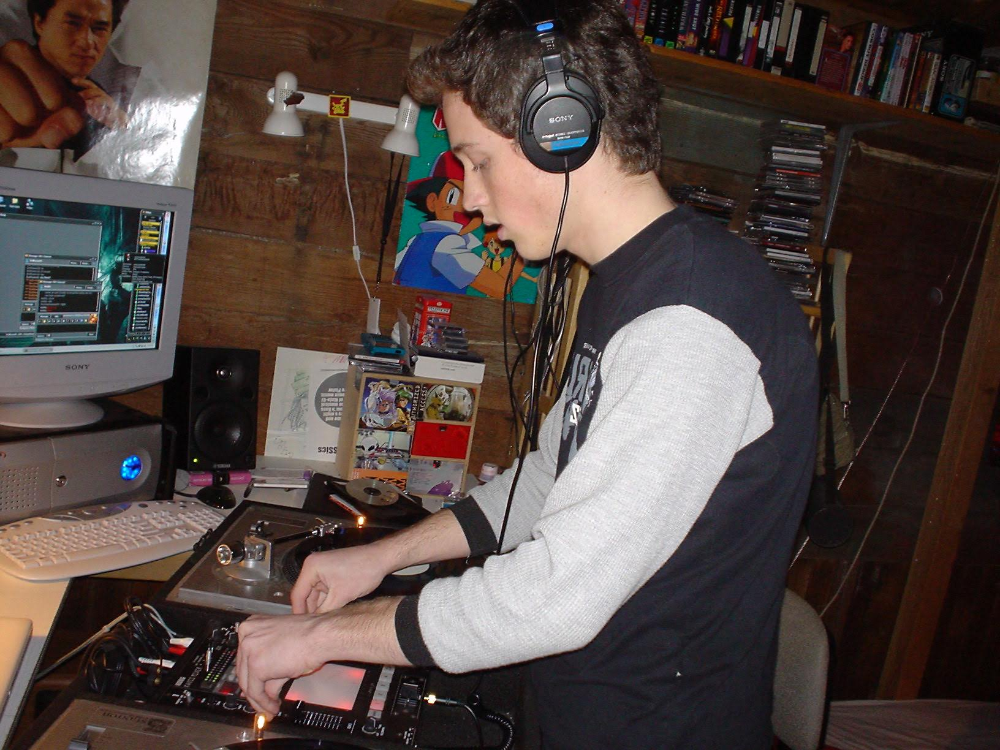

+++
title = "a little baby DJing across Japan"
template = "project.html"
date = 2026-10-13

[extra]
kind = "project"
link_title = "a little baby DJing across Japan"
cover = "baby-in-osaka/FIL4235.jpg"
gradient_from = "#8CFFE8"
gradient_to = "#FF4B8A"
text = "#140816"
+++

_baby flynn preparing for Japan, AIM in the background_

### STORY TIME!

I have been a DJ and VJ in various capacities my whole life, and I never thought about writing down anything until I discovered a file on an old external hard drive (a big IDE thing, not a nice SSD we have today). Most of the time when I speak about it, it sounds like a pretty tall tale. I don't mind being wrapped in enigma describing my time in Japan, but most of it is because I remember a lot less than you would expect? good reasons described below (surprise, it's alcohol).

I originally took my first trip to Japan when I was sixteen through a school sponsored trip, a dozen of my mates went over and stayed with host families for a week long education immersion type exchange. The schools did this, alternating years between sending students too and from Vashon WA and Himeji JP. It was more than enough to desperately fuel me to go back to the country, for ALL the reasons.

During 2002, I had recorded and _blindly_ send out **~100+ CD "demo" recordings** of my super sick skillz to various clubs across japan, leaning on my ~3 years of language to decipher the cryptic web (or lack of) info online for the JP electronic music scene, addressed of clubs, various individuals before doxxing was a thing, etc. I did hand write these letters using my time in Japanese class under the guise of homework, with little kanji, so to them I sounded like a kindergarten student sending a fan letter. Turns out a lot of clubs actually responded to me, unknowing that I was a super baby-faced looking 18 year old kid, but I got booked (after lots of negotiation) for 23 nights over a 24 week period.

The next step was natural. I booked a one-way ticket to Tokyo! Packing exactly two changes of clothes, no toiletries, and approximately ~80 vinyl records with a collapsible dolly that was _very_ much overloaded and flimsy as shit. I can't believe my parents thought it was ok to let their teenage son leave the country with nearly nothing outside of some wax and ~$600 in cash he had saved up from his part time job... They did send me with a "letter" to present to customs though! Saying it was "ok, he has permission". I still can't believe that worked, but also this was pre google maps, and I didn't even own a cell phone at the time!

Fast forward - I landed in Narita, booked it straight to Shibuya on the train, and met some homies that grew up a block away from me on Vashon Island as almost an obligation (this was setup previously). They were way older and forced to house me temporarily because their **MOM** called them, saying there was a neighbor coming and they needed to look after me. It turned out pretty god damned great, because Remi and Cal met up with me, records and all in the front of the east JR exit in Shibuya with a cold Asahi (yes I was not even 18)

We walked way, way, way too long to a venue they were playing a show at that very night. It was about 1am when we showed up, and the building was literally 20ft wide, 200ft long, and 6 stories tall. From the outside it honestly defied logic or reason to why it existed in the first place, but every floor was a different DJ and a different bar. The first floor was yakitori, but 鶏の全て (that's _every_ part of the fuckin chicken). I was unprepared for how delicious it would possibly taste - weird cuts, feet, head, beak, etc. Something I still haven't had again and have been told that was pretty weird regardless for Japan.

While moving around the country, sneaking onto trains and maximizing my ultra white privilege as a dumb 外人 , I slept in a lot of カプセルホテル (capsule hotels), meant for traveling businessmen which were still mad cheap at the time, and also the old ラブホ (love hotels) who had a cheap nice rates for overnights when it wasn't booked up with people fuckin'

Long story short, I showed up to my actual first booking in Osaka (大阪にエールを送る). The dudes that ran it let me come in the day before to do a "practice set" and learn on the gear they had. There were another two DJ's there too, and they each played two records each, and then watched me pretty intensely while also educating me on how to level my tracks for the _extremely_ loud sound system they had there. I'm pretty sure they mostly didn't want me to blow out their very expensive speakers honestly. It was the first time I had ever played on something that big, and boy does it feel like you are summoning raw natural thunder the first time you do it. The next night, the show went _extremely_ well, with local MCs jumping on the mic and hyping up the audience, I felt like LTJ Bukem. I had also not ever played for a crowd over 50 people, so quadrupling that was pretty intimidating and I honestly kind of 'blacked out' during the whole set - everyone said it was really good. So I kept on "touring: around the country, spurred on by that club owner giving me the thumbs up to all the others (yeah... they all knew each other of course)

Reconciling that experience a lot later, I did realize that they were vetting me to see if I would suck ass playing at their very nice three-story open room club. Also like I said before, I'm sure they were equally as concerned for me utterly destroying their sound system, the levels were 100% on the honor system. I must have done something right, and at the time foreigners playing niche electronica was pretty rare. 

The whole reason for writing all of this is because I actually found the original "practice recording" as an mp3 on one of my old hard drives. I did go on to play a crazy amount of shows, and genuinely not see the daylight for quite some time. I regret nothing, made a lot of friends, had some wild experiences, slept on a park bench a few times, etc. Much better than a dumb ass euro backpack trip (but seriously you shouldn't travel Japan in earnest if you speak none of the language). You can stream or download it below:

<audio controls preload="metadata" src="https://ia600903.us.archive.org/24/items/re-flex-bright_202610/ReFlex%20-%20%E5%A4%A7%E9%98%AABRIGHT.mp3" style="width: 100%"></audio>

<a href="https://ia600903.us.archive.org/24/items/re-flex-bright_202610/ReFlex%20-%20%E5%A4%A7%E9%98%AABRIGHT.mp3" style="font-weight: 700">download</a>

Notes about the actual set:
- I did realize, but was probably the first person in the country to have a 12" of [twist 'em out](https://www.youtube.com/watch?v=1GU9p35eNH4) by Dillinja, which I got literally two days before I left, and was a massssssssive tune. That song alone probably was the whole reason why it all went so well
- Some of those records I played were so old, picked up second hand from Compound and Platinum records in Seattle and they predated me by a lot, but boy do they still hold up even now.
- 18 year old me had some fucking banger tracks, I would have given me big ups too.
- I learned that everything well mixed sounds a _lot_ better on very large sound systems. DJs now have it super fuckin easy, is the moral of the whole story.
